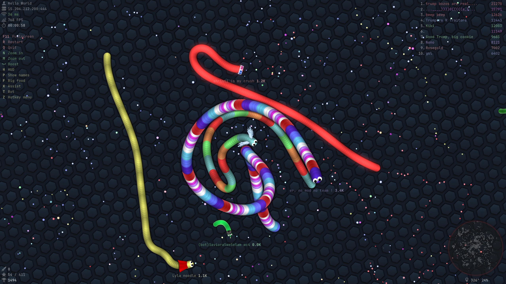

# Roshan.io
## A light, fast desktop client for Slither.io - by Roshan

This is **Roshan.io**, a modified build of [Vlither](https://github.com/for-loop9/vlither) (GPL-3.0).

### What's new in this build
- **FPS lock** - default **60 FPS**, adjustable in Settings (30 / 45 / 60 / 90 / 120 / 144 / 165 / 240 / Unlimited).
  Uses a high-resolution timer, so it uses very little CPU. Drops to 30 FPS automatically while the window is
  in the background. The old behaviour (uncapped, 100% GPU) was the main reason the game felt heavy.
- **Lite textures (default ON)** - half-resolution texture atlas + background (the original Slither atlas size).
  ~4x less RAM and VRAM (the 7168x9216 atlas alone was ~260 MB decoded / ~350 MB on the GPU), and the download
  is much smaller. Switch it off in Settings (restart needed) and drop in the optional HD textures pack to get
  the old look.
- 2 frames in flight instead of 3: lower input latency and slightly less memory.
- **New UI / UX** - violet + cyan dark theme everywhere, glass card title screen, custom buttons, stat pills,
  animated 3D perspective-grid background and floating glow orbs (all drawn with the UI draw list: no extra
  textures, almost no cost).
- **3D animated logo** - extruded ROSHAN.IO logo that tilts toward your mouse, with a moving shine, plus an
  animated 3D "Made by Roshan" credit. A small `roshan.io` watermark shows in-game; optional FPS counter.
- Window title, version label and credits are all **Roshan.io**.

### Build (Windows .exe)
Upload the files from INSIDE this folder to the root of a GitHub repo (include the hidden `.github` folder) and run the **Build Roshan.io (Windows x64)** workflow
(Actions tab -> Run workflow). The `.exe` zip appears under *Artifacts*.
Shaders are pre-compiled in `app/res/shaders/bin`, so no Slang compiler is required.

Run `roshan-io.exe` from inside its folder (it loads `app/res/...` relative to the exe).

---

# Original Vlither README
# Vlither
## A Desktop Client for Slither.io

Vlither is a client for [Slither.io](https://slither.io) which can run outside the browser. It is written in C and uses Vulkan for rendering all the graphics, resulting in faster rendering. This implementation is based on [protocol version 19](./game1107241958.js), which was the latest version on web in May 2026. It has been tested on Windows 11, Debian 13, Ubuntu 24.04, and LMDE7 (AMD and Intel).

### Running Instructions
No dependencies are required to run the program. If your GPU supports at least Vulkan 1.0, there should be no issues. Download the [latest release](https://github.com/for-loop9/vlither/releases/latest).

### Build Instructions
Prerequisites
- [Premake](https://premake.github.io) for generating makefiles
- [Vulkan SDK](https://www.lunarg.com/vulkan-sdk)
- [Python 3](https://www.python.org/downloads)
- GCC
- mingw-w64 (if targetting Windows)
- GDB if you plan to debug
- [CompileDB](https://github.com/nickdiego/compiledb) for intellisense
- Make
- X11 dependencies (only for Linux, see [here](https://www.glfw.org/docs/latest/compile.html))

For simplicity, _building_ is only documented for Linux.

Make sure the `VULKAN_SDK` environment variable is set (and acquire `vulkan-1.lib` and place it in `$VULKAN_SDK/lib` if targetting Windows).

```bash
git clone https://github.com/for-loop9/vlither.git
cd vlither
python3 build.py 2 # compile shaders
python3 build.py 0 # debug build
./build/bin/linux_x86_64_debug/app
```
You may also work on the project with VS Code by opening the `.code-workspace` file. Make sure you have the required extensions installed:
- [C/C++ tools](https://marketplace.visualstudio.com/items?itemName=ms-vscode.cpptools)
- [clangd](https://marketplace.visualstudio.com/items?itemName=llvm-vs-code-extensions.vscode-clangd)
## Features

- Upscaled/sharper textures
- Supports all 66 skins and 32 accessories
- Custom skin
- Server selection
- Zoom
- Kill count
- Bot ([Saya's implemenation](https://github.com/saya-0x0efe/Slither.io-bot))

## 

## License
This project is licensed under the GNU General Public License v3.0 - see the [LICENSE](./LICENSE) file for details.

## Disclaimer & Copyright
All game assets, artwork, trademarks, and game content are the property of [Slither.io](https://slither.io).  
This project does **not** claim ownership over any game-related intellectual property. This application is provided for convenience and performance purposes only and is not affiliated with or endorsed by the original game developer.

Permission to open source this project was granted by the original developer. This grant of permission does not transfer any intellectual property rights, and all original copyrights and trademarks remain with their respective owners.
